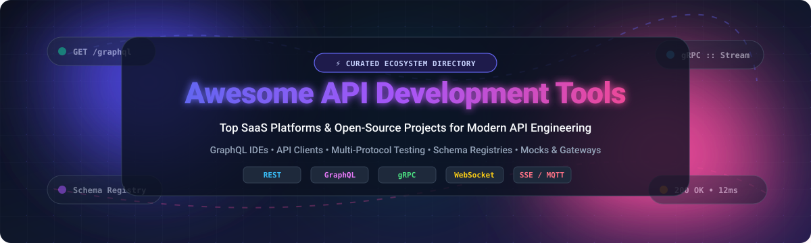

# 🚀 Awesome API Development Tools

  
  
  
  
  

  

  <strong>A curated list of top SaaS products and open-source GitHub projects for modern API engineering 🌟 Star if you like it! 🌟</strong>

  <em>Explore cutting-edge GraphQL IDEs, REST & gRPC API clients, schema registries, mock servers, and multi-protocol testing suites.</em>

---

## 📑 Table of Contents

- [📊 Sector Overview & Market Dynamics](#-sector-overview--market-dynamics)
- [☁️ SaaS/Hosted Platforms](#️-saashosted-platforms)
- [💻 Open-Source GitHub Projects](#-open-source-github-projects)
- [🤝 How to Contribute](#-how-to-contribute)
- [💖 Support & Sponsorship](#-support--sponsorship)
- [📈 Star History](#-star-history)
- [⚖️ Disclaimer](#️-disclaimer)

---

## 📊 Sector Overview & Market Dynamics

The global API development and management market is estimated at **$8B–$8.7B** and projected to surpass **$35B–$50B+** over the next decade. The sector is **moderately concentrated at the top**—where major enterprise and cloud leaders capture roughly half the overall market value—while remaining **highly fragmented across the broader developer ecosystem**, characterized by specialized, developer-first startups and open-source tooling competing aggressively in client testing, schema registries, and multi-protocol workflows.

---

## ☁️ SaaS/Hosted Platforms

| Platform | Company Valuation / Revenue | Starting Paid Price | Free Tier / Trial Limit | Key Focus & Capabilities |
| :--- | :--- | :--- | :--- | :--- |
| **[Shopify GraphiQL App](https://shopify.dev/docs/api/usage/api-exploration/admin-graphiql-explorer)** | **$137B–$210B** Market Cap (~$8.9B–$11.6B ARR) | Free for Partners; merchant stores start at **$5/mo** (Starter) or **$39/mo** (Basic, or $29/mo billed annually) | **Free forever** for Partner development stores (unlimited dev stores and API testing, checkout disabled until client transfer); or **3-day free trial** for standard merchant stores | Shopify-specific GraphiQL explorer for inspecting and executing Admin API queries and mutations directly against store data. |
| **[Postman](https://www.postman.com/)** | **$5.6B** Valuation (~$313M ARR) | **$9/user/month** (Solo, billed annually) or **$19/user/month** (Team, billed annually) | **Free forever**: Limited strictly to **1 user**, 10,000 Postman API calls/month, unlimited collection runs, and 5 integrations | AI-native multi-protocol API client supporting HTTP, GraphQL, and gRPC with local mock servers, automated testing, and team workspaces. |
| **[Insomnia](https://insomnia.rest/)** | **$2.0B** Valuation (~$100M+ ARR via Kong Inc.) | **$10/user/month** (Pro, billed annually) or **$12/user/month** (billed monthly) | **Free forever** (Essentials plan): Up to **3 users** on Git Sync, unlimited local/cloud projects, and **1,000 mock server requests/month** | Multi-protocol API design, debugging, and testing client supporting HTTP, REST, GraphQL, gRPC, WebSockets, and Inso CLI. |
| **[Apollo Studio](https://studio.apollographql.com/)** | **$1.5B** Valuation (Apollo Graph, Inc.) | **$5 per million requests** (Developer Plan pay-as-you-go, after promotional credits) | **Free forever**: Up to **3 developers**, router throughput capped at **60 requests per minute (RPM)**, and 1-day metric/check retention | GraphQL schema registry and supergraph management platform with managed Apollo Federation, schema checks, and sandbox explorer. |
| **[Hasura Console](https://hasura.io/)** | **$1.0B** Valuation (~$30M–$40M ARR) | **$1.50 per project hour** (~$1,000+/mo for continuous 24/7 uptime) + $0.13/GB data passthrough | **Free forever** (Hasura Cloud Free): Up to **3 projects**, capped at **3 Million API requests/month** and ~100 MB data passthrough | Managed GraphQL engine console featuring an embedded API explorer/playground and data relationship browser over databases. |
| **[Banana Cake Pop](https://chillicream.com/)** | **Private / Boutique** (ChilliCream Inc., funding/ARR undisclosed) | Free community edition; enterprise support and team workspaces via customized licensing | **Free forever** for personal workspaces, local server middleware, and individual schema exploration | Interactive GraphQL IDE optimized for the .NET/Hot Chocolate ecosystem, offering query execution, document sharing, and schema visualization. |

---

## 💻 Open-Source GitHub Projects

Curated open-source API development tools, GraphQL explorers, and multi-protocol clients, sorted in descending order by community GitHub star count:

1. **[Hoppscotch](https://github.com/hoppscotch/hoppscotch)** 
   - **Description**: Open-source API development ecosystem (MIT) — the leading lightweight, web-first Postman alternative.
   - **Features**: REST, GraphQL, WebSocket, SSE, and MQTT support; collections, environments, and request history; self-hosted edition available for full data ownership; CLI for CI/CD pipelines; desktop app built with Tauri.
   - **Tech Stack**: Vue.js, TypeScript.
   - **Best For**: Developers wanting a polished, privacy-friendly multi-protocol API client with full self-hosting and zero account requirement.

2. **[Bruno](https://github.com/usebruno/bruno)** 
   - **Description**: Fast and git-friendly open-source API client (MIT) challenging traditional cloud-dependent clients.
   - **Features**: Stores API collections directly as plain text files in your repository using Bru markup; native Git version control integration; offline-first architecture; supports REST and GraphQL.
   - **Tech Stack**: Electron, React, Node.js.
   - **Best For**: Engineering teams wanting their API collections checked in and versioned alongside source code.

3. **[Insomnia (Open-Source)](https://github.com/Kong/insomnia)** 
   - **Description**: Open-source desktop API client (Apache-2.0 core) powered by Kong for designing, debugging, and testing modern APIs.
   - **Features**: Multi-protocol support (HTTP, gRPC, GraphQL, WebSockets, SOAP, SSE), pre-request/after-response scripting, code generation in 10+ languages, environment variables, and theme support.
   - **Tech Stack**: Electron, React, TypeScript.
   - **Best For**: Developers wanting a mature, full-featured desktop client with seamless local or Git-synced workflows.

4. **[Hasura GraphQL Engine](https://github.com/hasura/graphql-engine)** 
   - **Description**: Blazing-fast GraphQL engine (Apache-2.0) that generates instant, realtime GraphQL and REST APIs on databases.
   - **Features**: Instant GraphQL APIs over PostgreSQL, MySQL, SQL Server, and MongoDB; built-in fine-grained access control; event triggers; embedded Console and GraphQL API Explorer for query testing.
   - **Tech Stack**: Haskell, PostgreSQL, React.
   - **Best For**: Teams wanting to instantly generate production-ready GraphQL backends and explore them inside an integrated UI.

5. **[Swagger UI](https://github.com/swagger-api/swagger-ui)** 
   - **Description**: The industry-standard visual API documentation and interactive testing interface (Apache-2.0) for OpenAPI (Swagger) specifications.
   - **Features**: Renders dynamic, interactive documentation from OpenAPI definitions; allows developers to execute live sandbox requests directly from browser docs; widely embeddable in backend frameworks.
   - **Tech Stack**: JavaScript, React.
   - **Best For**: Developers and teams needing canonical, interactive OpenAPI documentation and live browser-based request execution.

6. **[Yaak](https://github.com/mountain-loop/yaak)** 
   - **Description**: Modern, desktop REST, GraphQL, and gRPC client (MIT) built with Rust and Tauri for maximum speed and minimal memory footprint.
   - **Features**: Extremely lightweight native desktop client; tabs, environment variables, authentication helpers, full dark/light theme support; private local-first storage.
   - **Tech Stack**: Rust, Tauri, React, TypeScript.
   - **Best For**: Developers seeking an ultra-fast, native, memory-efficient alternative to Electron-heavy API clients.

7. **[GraphiQL](https://github.com/graphql/graphiql)** 
   - **Description**: The canonical reference GraphQL IDE (MIT) from the GraphQL Foundation — the original and most widely embedded GraphQL explorer.
   - **Features**: In-browser query writing, auto-completion, validation, interactive documentation explorer, syntax highlighting, and inline error reporting.
   - **Tech Stack**: React, TypeScript.
   - **Best For**: Embedding directly into GraphQL server engines or minimal standalone GraphQL exploration.

8. **[Scalar](https://github.com/scalar/scalar)** 
   - **Description**: Beautiful, modern OpenAPI interactive documentation and testing client (MIT).
   - **Features**: Modern visual alternative to Swagger UI with an integrated API client; code snippet generators; offline capabilities; highly customizable theme system.
   - **Tech Stack**: Vue.js, TypeScript.
   - **Best For**: Engineering teams wanting modern, gorgeous interactive API reference docs and embedded client playgrounds.

9. **[GraphQL Playground](https://github.com/graphql/graphql-playground)** 
   - **Description**: Enhanced GraphQL IDE (MIT) built on GraphiQL components with added workflow and collaboration features.
   - **Features**: Interactive multi-column schema docs, automatic schema reloading, GraphQL Subscriptions support, query history, HTTP header configuration, and tabs.
   - **Tech Stack**: React, TypeScript.
   - **Best For**: Teams needing multi-tab query workspaces and GraphQL subscription debugging.

10. **[Mockoon](https://github.com/mockoon/mockoon)** 
    - **Description**: The easiest and quickest way to run mock REST APIs locally (MIT).
    - **Features**: Zero cloud dependency; unlimited mock endpoints, route regexes, proxy mode, custom response rules, JSON templating, and automated CLI runner for CI/CD test suites.
    - **Tech Stack**: Electron, Node.js, TypeScript.
    - **Best For**: Frontend and backend developers needing fast local API mocking without third-party account requirements.

11. **[Altair GraphQL Client](https://github.com/altair-graphql/altair)** 
    - **Description**: Feature-packed GraphQL IDE (MIT) available across desktop, browser extensions, and web.
    - **Features**: Queries, mutations, and subscriptions; file upload via multipart spec; schema downloading; collection export/import; environment management; script extensions.
    - **Tech Stack**: Angular, TypeScript, Electron.
    - **Best For**: Dedicated GraphQL developers needing advanced GraphQL features like file uploads and subscription inspection.

12. **[API Dash](https://github.com/foss42/apidash)** 
    - **Description**: Beautiful, lightweight, open-source cross-platform API client (Apache-2.0) built with Flutter.
    - **Features**: Minimal resource usage; clean modern UI; supports REST and GraphQL; code generation in multiple languages; completely free and offline-first.
    - **Tech Stack**: Flutter, Dart.
    - **Best For**: Developers seeking a clean, fast desktop API client without account paywalls or high memory overhead.

---

## 🤝 How to Contribute

Contributions are warmly welcomed! To contribute:

1. **Fork** the repository.
2. **Add/Edit** entries in `README.md` (maintain the alphabetical/star-sorted order and consistent schema).
3. **Include**: Platform/tool name, link, concise 1–2 sentence description, license (for open-source), and accurate pricing/tier details.
4. **Submit a Pull Request** with a descriptive summary of your changes.

---

## 💖 Support & Sponsorship

If you find this repository helpful for your API workflows, please consider supporting the project:

- ⭐ **Star this repository** to help others discover it!
- 🍴 **Fork and share** it with your developer community.
- ☕ **Buy me a coffee & support ongoing maintenance**: [Sponsor on GitHub](https://github.com/sponsors/ishandutta2007)

---

## 📈 Star History

---

## ⚖️ Disclaimer

- This is a **community-curated** list — not exhaustive and not an official corporate endorsement.
- API development tools handling schemas, credentials, and request payloads must comply with data protection regulations (GDPR, CCPA, etc.) and implement strict local security for secrets.
- **Protocol Depth vs. Breadth**: Dedicated GraphQL IDEs (GraphiQL, Altair, GraphQL Playground, Banana Cake Pop) prioritize specialized schema introspection and query syntax; multi-protocol clients (Postman, Insomnia, Hoppscotch, Bruno, Yaak, API Dash) offer broader multi-protocol coverage (REST, gRPC, WebSocket); registries (Apollo GraphOS) focus on schema governance and federation.
- **Pricing & Quota Verification**: SaaS pricing tiers, API limits, and free plan quotas fluctuate over time. Always verify active rates directly with official vendor pricing pages before architecting enterprise workflows.

---

  <strong>Made with ❤️ for developers, API architects, and engineering teams worldwide.</strong>

